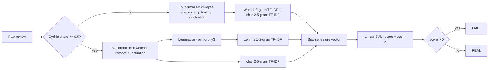

# Technical Documentation: Fake Review Detection (EN / RU)

## 1. Task
| | |
|---|---|
| **NLP task** | Binary text classification |
| **Input** | One product review (raw text, English or Russian) |
| **Output** | Label `fake` (machine-generated) or `real` (human-written) + a real-valued score (SVM margin; > 0 = fake) |
| **Labels** | `1 = fake` (generated by a language model), `0 = real` |
| **Success criterion** | Macro-F1 on the held-out test split, compared with a majority-class and a stylometric baseline; ROC-AUC as threshold-free check |
| **Intended users** | Marketplace moderation teams / researchers: a fast, explainable first filter, not a final verdict |

## 2. Pipeline



Training: `train split -> CV hyperparameter search (C) -> refit on full train -> checkpoint (.joblib) -> one evaluation on test`.

## 3. Dataset cards

### English: Salminen et al. (2022), "Creating and detecting fake reviews of online products"
- Source: OSF https://osf.io/tyue9/ (mirror used: GitHub `SayamAlt/Fake-Reviews-Detection`). Check the source for licence and usage terms; the raw file is not redistributed in this repo.
- 40,432 rows → **40,412** after removing empty and exactly duplicated texts. 10 Amazon product categories.
- Labels: `OR` = original Amazon review (real, 0); `CG` = generated by a fine-tuned GPT-2 (fake, 1). Labels come with the dataset.
- Class balance: 50.0% fake / 50.0% real (train 49.98% fake, test 49.98% fake).
- **Split:** stratified 80/20, seed 42 → **train 32,329 / test 8,083**. Validation = cross-validation folds inside train (no separate fixed validation set).
- Known artifact: 35% of fakes end with punctuation vs 90% of real reviews (GPT-2 truncation). Handled by the artifact-controlled preprocessing.

### Russian (built for this project)
- **Real:** RuReviews (Smetanin & Komarov, 2019), women's clothing & accessories store reviews, GitHub `sismetanin/rureviews`. Check the source for licence; the raw file is not redistributed. Filtered to 3–80 words, ≥80% Cyrillic letters, deduplicated.
- **Fake:** generated by us (`generate_ru.py`) with **ruGPT-3 small** (800 generated → 764 kept) and **Qwen2.5-0.5B-Instruct** (288 → 258 kept), each conditioned on the sentiment and length of a randomly drawn real review (never its text). Removed: non-Cyrillic outputs, refusals or meta text, < 3 words, duplicates.
- **Main dataset:** 1,022 fake + **1,022 real** (real sampled to match the fakes' sentiment distribution) = 2,044.
- **Split:** stratified by source (real / ruGPT-3 / Qwen) 80/20, seed 42 → **train 1,635 / test 409** (test: 204 real, 153 ruGPT-3, 52 Qwen).
- **Modern-LLM probe (never used for training or selection):** 162 reviews written by a frontier LLM (Claude) + 162 real reviews from a disjoint pool.

### Leakage prevention
- Duplicates removed before splitting; the test split is fixed before any tuning.
- All vectorizers are fit inside each CV fold (sklearn `Pipeline`), and on the train split only for the final model.
- Russian fakes were conditioned only on the *sentiment and length* of real reviews, not on their text.
- Near-duplicate check (`defense_eval.py`): max cosine similarity (word 1–2-gram TF-IDF) of every test review to any train review.
  - EN: 47 / 8,083 test reviews ≥ 0.9 (133 ≥ 0.8); median max-similarity 0.22. F1 without them: 0.956 (unchanged).
  - RU: 0 test reviews ≥ 0.8; median 0.19.

## 4. Preprocessing and tokenization
| Step | English | Russian |
|---|---|---|
| Normalization | collapse whitespace, strip trailing punctuation (removes the GPT-2 truncation shortcut) | lowercase, replace all punctuation with spaces, collapse whitespace |
| Lemmatization | none | pymorphy3 (`MorphAnalyzer().parse(w)[0].normal_form`) |
| Word tokenizer | sklearn `TfidfVectorizer` default: lowercase, regex `(?u)\b\w\w+\b` (tokens of ≥ 2 word characters) | same, applied to lemmas |
| Word features | 1–2-grams, `min_df=2`, `max_features=200,000`, `sublinear_tf=True` | same |
| Char features | `char_wb` 2–5-grams, `min_df=3`, `max_features=300,000`, `sublinear_tf=True` | same, on normalized text |
| Stop-words | kept (function words carry style signal) | kept |

There are no token IDs, padding, truncation or attention masks: the model is not a neural network. Each review becomes a sparse TF-IDF vector of fixed length (vocabulary size). Long reviews are not truncated.

## 5. Model and training configuration
| | English (proposed) | Russian (proposed) |
|---|---|---|
| Features | word (1–2) + char (2–5) TF-IDF, concatenated (`FeatureUnion`) | lemma (1–2) + char (2–5) TF-IDF (`ColumnTransformer`) |
| Classifier | `LinearSVC` (L2-regularized, squared hinge loss, liblinear dual coordinate descent) | same |
| Prediction | `score = w·x + b`; fake if score > 0 | same |
| Trainable parameters | 235,118 weights + 1 bias | 24,561 weights + 1 bias |
| Hyperparameter search | C ∈ {0.05, 0.1, 0.25, 0.5, 1, 2}, 3-fold stratified CV on train, macro-F1 | C ∈ {0.05 … 4}, 5-fold stratified CV on train |
| **Selected C** | **1** (CV F1 0.9487 ± 0.0016) | **0.1** (CV F1 0.9664 ± 0.0093) |
| Seed | 42 (splits, CV shuffling, LinearSVC) | 42 |
| Fit time (full train, 2-vCPU Xeon 2.1 GHz) | 17.6 s | 0.5 s |
| Checkpoint | `results/model_en.joblib` (10.7 MB) | `results_ru/model_ru.joblib` (1.2 MB) |

Baselines on the same splits: majority class (`DummyClassifier`), stylometric features + logistic regression, word or lemma TF-IDF + logistic regression (lbfgs, log loss, C tuned by CV: EN C = 16, at the upper edge of the grid; RU C = 8).

**Why no epochs, learning rate or batch size?** LinearSVC and logistic regression minimize a convex loss with a deterministic solver run to convergence, so there is no epoch loop or learning-rate schedule to tune; regularization strength C is the main hyperparameter. To still show iterative training dynamics, `defense_eval.py` also trains an equivalent linear model with **SGD** (log loss, constant learning rate 0.3, L2 α = 1e-6, mini-batch 256, 25 epochs) on a 90/10 (EN) or 85/15 (RU) train/validation split of the train data, and plots train/validation loss and validation F1 per epoch.

**Overfitting diagnosis:** learning curves show train F1 ≈ 1.00 and validation F1 rising with more data (EN 0.88 → 0.95; RU 0.91 → 0.97). This is a variance gap: the models fit the training set almost perfectly and would benefit from more data. The validation curve over C picks the point where validation F1 peaks; larger C (less regularization) does not improve it. Classes are balanced (50/50), so no re-weighting was needed.

## 6. Results (held-out test, evaluated once)
| Model | Lang | Acc | Prec (macro) | Rec (macro) | F1 (macro) | ROC-AUC | Test n |
|---|---|---|---|---|---|---|---|
| Majority-class baseline | EN | 0.500 | 0.250 | 0.500 | 0.333 | 0.500 | 8,083 |
| Stylometric + LR (raw text) | EN | 0.859 | 0.859 | 0.859 | 0.859 | 0.930 | 8,083 |
| Word TF-IDF + LR | EN | 0.949 | 0.949 | 0.949 | 0.949 | 0.988 | 8,083 |
| **Proposed: word+char TF-IDF + SVM** | EN | **0.956** | **0.956** | **0.956** | **0.956** | **0.992** | 8,083 |
| Majority-class baseline | RU | 0.499 | 0.249 | 0.500 | 0.333 | 0.500 | 409 |
| Stylometric + LR (controlled) | RU | 0.726 | 0.727 | 0.726 | 0.726 | 0.800 | 409 |
| Lemma TF-IDF + LR | RU | 0.949 | 0.949 | 0.949 | 0.949 | 0.993 | 409 |
| **Proposed: lemma+char TF-IDF + SVM** | RU | **0.956** | **0.956** | **0.956** | **0.956** | **0.994** | 409 |

Per class (proposed): EN real P 0.956 / R 0.957, fake P 0.957 / R 0.955; RU real P 0.947 / R 0.966, fake P 0.965 / R 0.946.
Confusion matrices `[[TN, FP], [FN, TP]]`: EN `[[3869, 174], [180, 3860]]`; RU `[[197, 7], [11, 194]]`.
RU recall by source on test: ruGPT-3 0.935, Qwen 0.981; real reviews correctly kept 0.966.
**Modern-LLM probe (RU, never seen):** the final model catches **27.8%** of the 162 fakes and keeps 96.3% of real reviews (macro-F1 0.570).

Inference (single review, 2-vCPU Xeon 2.1 GHz): EN median 1.9 ms (p95 3.9 ms); RU median 2.5 ms (p95 3.6 ms). Batch throughput: EN ≈ 1,690 reviews/s, RU ≈ 4,330 reviews/s.

Earlier exploratory experiments (`experiments.py`, `experiments_ru.py`, `cross_category_fair.py`) use the same EN test split with fixed, untuned settings; they provide the shortcut ablation, cross-category, cross-language and cross-generator analyses described in the report.

### Metric definitions
- **Precision** = TP / (TP + FP); **Recall** = TP / (TP + FN); **F1** = harmonic mean of the two.
- **Macro averaging**: compute per class, then average with equal weight (classes are balanced, so macro ≈ micro ≈ weighted here).
- **ROC-AUC**: probability that a random fake gets a higher score than a random real review; threshold-free; 0.5 = random.
- **What they do not measure**: performance on human-written paid fakes, on modern-LLM fakes (see probe), on other domains or platforms, or calibration of the score as a probability.

## 7. Reproduce
```bash
pip install -r requirements.txt
# data (not redistributed)
curl -L -o data/fake.csv "https://raw.githubusercontent.com/SayamAlt/Fake-Reviews-Detection/main/fake%20reviews%20dataset.csv"
curl -L -o data_ru/rureviews.csv "https://raw.githubusercontent.com/sismetanin/rureviews/master/women-clothing-accessories.3-class.balanced.csv"
python defense_eval.py ru      # ~1 min: tuning, curves, test results, results_ru/model_ru.joblib
python defense_eval.py en      # ~15-25 min on a laptop CPU: same for English, results/model_en.joblib
python predict.py "Отличное платье!" "Great product."   # CLI inference
python -m streamlit run app.py                           # web demo (http://localhost:8501)
```
Exploratory analyses: `experiments.py` (~4 min), `cross_category_fair.py`, `experiments_ru.py`; report: `make_report.py`. Regenerating the Russian fakes needs `requirements-generate.txt` and `generate_ru.py` (~35 min CPU; outputs already included in `data_ru/`).
On Windows use `py` instead of `python`, and `curl.exe` instead of `curl`.

## 8. Files
| Path | Purpose |
|---|---|
| `defense_eval.py` | Reported results: tuning, learning/validation/epoch curves, test metrics, confusion matrices, timing, near-duplicates, checkpoints |
| `experiments_core.py`, `experiments.py` | English data loading/cleaning; exploratory models, shortcut ablation, n-gram analysis |
| `cross_category_fair.py` | Size-matched unseen-category test |
| `ru_data.py`, `experiments_ru.py`, `generate_ru.py` | Russian data, exploratory experiments, fake generation |
| `predict.py` | Inference + `explain()` (preprocessing steps, top features) |
| `app.py` | Streamlit demo |
| `results/`, `results_ru/` | Metrics (`defense_results_*.csv`, `defense_report_*.json`), plots (`defense_*.png`), checkpoints (`*.joblib`, git-ignored) |

## 9. Web demo
`app.py` loads the two checkpoints once (`st.cache_resource`), detects the language, and shows: the label, the raw SVM score, a squashed "fake-ness" bar (display only, **not a calibrated probability**), the normalized text, lemmas (RU), tokens, the number of non-zero features, and the features that push the score toward fake or real (TF-IDF value × weight).

## 10. Limitations and ethics
- English fakes are GPT-2 (2019) outputs; results are an upper bound for older generators.
- Machine-generated ≠ fraudulent; human-written paid fakes are not covered.
- The Russian fakes come from small models and our prompts (prompt-word echo such as "магазин", "отзыв"); one product domain; the modern-LLM probe has only 162 reviews.
- Real reviews with typos or non-standard phrasing are sometimes flagged as fake, which is a fairness risk for non-native writers. Use as a moderation aid with human review, not for automatic penalties.
